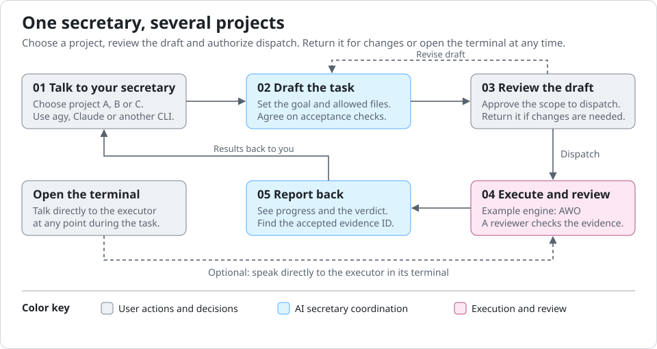
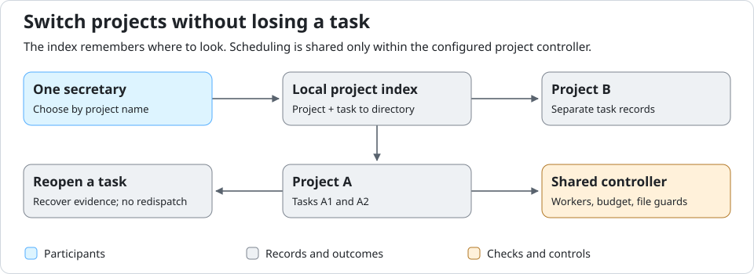
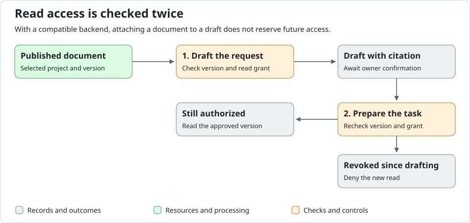

# Multi-Agent Inter-harness Dispatch - Your Multi-Agent Project Secretary

English | [Chinese](README.zh-CN.md)

When you juggle several coding or research projects at once, you should not have to hop across a dozen terminals to track what each AI changed. **MAID is your multi-agent project secretary**: talk to one secretary about your goals and boundaries, review a clear task draft before any work begins, and get concise, evidence-backed reports when independent review finishes.

Study a personal PDF, Markdown note, or authorized project document with [MAID study mode](docs/study.md). Choose a source, ask follow-up questions, and open a cited passage before saving your own notes.

## How it works



Tell your secretary which project you mean and what you want to achieve. It prepares a **task draft** spelling out the goal, the files that may change, and how success will be verified. Send the draft back if the scope is off; **nothing is dispatched until you explicitly approve it**. Execution and independent review can run on a compatible backend engine such as [AWO](https://github.com/cgy0071/agent-workflow-orchestrator), and your secretary reports the verdict and evidence ID back to you.

> MAID and AWO are two independent projects with separate releases; the documented dispatch-and-review workflow pairs MAID with a compatible AWO checkout.

## Core modules and usage

### 1. Flexible secretary interface, direct terminal escape hatch
Choose the local client you want as your secretary. From the MAID repository root, run **one** of the commands below. Antigravity CLI (agy) has a built-in selector; Claude Code and Codex CLI use the supplied JSON command profiles. You can still open an executor terminal directly.

~~~powershell
python maid.py --thread ./chat-agy chat --secretary agy
python maid.py --thread ./chat-claude chat --secretary ./examples/secretary-claude.json
python maid.py --thread ./chat-codex chat --secretary ./examples/secretary-codex.json
~~~

### 2. Draft-first approval gate
Every request produces an undispatched draft (`dispatched: false`) listing the target repository, allowed file scope, and verification check. No code is touched and no paid execution runs until you confirm.

```powershell
python maid.py request --profile <PROFILE> --thread <THREAD_DIR> --secretary agy "Fix sum in app.py"
python maid.py --thread <THREAD_DIR> start --confirm-execute # dispatch only after you approve the draft
python maid.py --thread <THREAD_DIR> status                  # check verdict and evidence ID without resending
```

### 3. Multi-project index and shared scheduling
A local index maps project and task names to their working directories so you can switch projects freely and reopen status checks after a terminal restart. When a project uses a shared AWO controller, multiple tasks can also share workers, budgets, and file-write guards.

```powershell
python maid.py runs --index <INDEX.json> --project research --run analysis status
python maid.py shared --index <INDEX.json> --project research status --task T-A
```



### 4. Authorized read-only project knowledge
Attach an authorized published document to `request` via `--directory <CATALOG.json> --project <PROJECT_KEY> --material <DOC_KEY>`. Version and permission checks run during both drafting and task preparation; once access is revoked, future reads are blocked.



### 5. Plain-language reporting
Your secretary leads with what happened and what it means for your project, translates internal jargon into plain language, and preserves exact numbers, verbatim quotes, evidence IDs, and open items (see [Secretary reporting rules](SECRETARY.md)).

## Three things that always stay in your hands

1. **Independent role choices**: pick your secretary separately from the worker that edits code.
2. **Explicit file boundaries**: each task gets its own thread, and you approve which files may change.
3. **Review before done**: never take a worker's word for it; wait for the independent review verdict and evidence ID.

## Let your AI set this up

You do not need to type setup commands by hand. Copy this prompt into your local AI assistant (Codex, Claude Code, Antigravity CLI (agy), or Cursor) to install and verify MAID safely:

~~~text
Help me set up Multi-Agent Inter-harness Dispatch (MAID) by following docs/setup.md in this repository.
First check Git, Python 3.10+, and installed AI clients. Ask me which folder to use, and install the documented release into a fresh subdirectory.
Run only maid.py doctor to verify the compatible backend.
Do not modify my existing projects, accounts, or keys, and do not make paid model calls or dispatch real work.
Report the check results and the next command, then wait for my decision.
~~~

## Further reading

- [Manual setup and walkthrough](docs/setup.md): full steps for installation, binding a Git repo, and profile setup
- [Multi-project indexing, shared scheduling, and troubleshooting](docs/setup.md#troubleshooting): index format, session recovery, and common fixes
- [Secretary reporting rules](SECRETARY.md): plain-language reporting and verbatim citation rules
- [AWO backend workflow and review engine](https://github.com/cgy0071/agent-workflow-orchestrator#readme): how isolated execution, independent review, and knowledge search work under the hood
