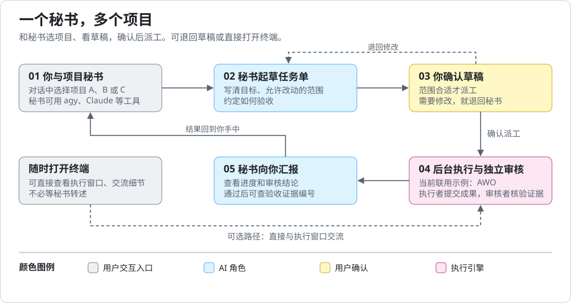
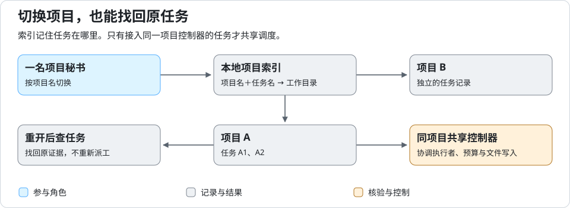
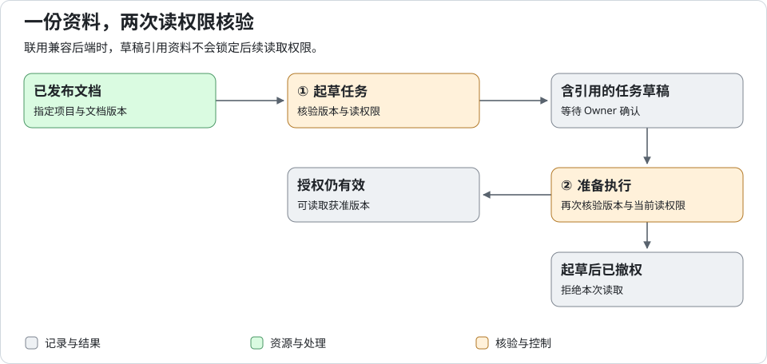

# Multi-Agent Inter-harness Dispatch · 你的多智能体项目秘书

[English](README.md) | 中文

同时推进好几个代码或科研项目时，你不用在十几个终端之间来回切窗口、反复核对 AI 改了哪里。**MAID 是你的多智能体项目秘书**：你只需要和一位秘书对话，交代目标和边界，它会帮你整理需求、起草任务单、等你点头后再派工，并在完成后把审核结果和证据整理好汇报给你。

打开[独立知识库学习入口](docs/study.md)，选一篇 PDF、一份 Markdown 笔记或已授权项目文档，说明想学什么。学习时可以追问、回到原文，或保存自己的理解。

## 它是怎么运作的



你和秘书商量好要做什么、属于哪个项目，秘书先交给你一份**任务草稿**——写明目标、允许修改的文件和验收方式。觉得范围不对就打回重写；**只有你明确确认后，任务才会真正派发**。执行和独立审核可交给兼容的后台引擎（如 [AWO](https://github.com/cgy0071/agent-workflow-orchestrator)），完成后由秘书把结果和证据编号汇报给你。

> MAID 与 AWO 是两个独立项目，各自发布和更新；当前文档演示的派工与审核流程搭配兼容版本的 AWO 运行。

## 主要模块与用法

### 1. 多工具秘书交互，随时直连终端
选择你想用的本地客户端担任秘书。在 MAID 仓库根目录运行下面任意一条命令即可。Antigravity CLI (agy) 使用内置选项；Claude Code 和 Codex CLI 使用仓库附带的 JSON 命令配置。需要直接和执行者交流时，仍可打开其终端。

~~~powershell
python maid.py --thread ./chat-agy chat --secretary agy
python maid.py --thread ./chat-claude chat --secretary ./examples/secretary-claude.json
python maid.py --thread ./chat-codex chat --secretary ./examples/secretary-codex.json
~~~

### 2. 先看草稿，确认后再派工
每次需求都会先生成一份未派工的草稿（`dispatched: false`），清楚列出目标项目、允许改哪些文件、用什么脚本验收。没经你确认，不会动你的代码，也不会触发付费执行。

```powershell
python maid.py request --profile <配置> --thread <任务目录> --secretary agy "修复 app.py 的求和函数"
python maid.py --thread <任务目录> start --confirm-execute   # 核对草稿无误后再派工
python maid.py --thread <任务目录> status                    # 随时查进度、审核结论和证据编号（不重派）
```

### 3. 多项目索引与共享调度
用一份本地索引把项目名、任务名和工作目录管起来。你可以随时在多个项目之间切换；关掉终端重新打开，也能直接查回原任务的进度和证据编号。如果同一项目配置了共享调度器，多任务还可以共享执行者、预算和文件写入保护。

```powershell
python maid.py runs --index <索引.json> --project research --run analysis status
python maid.py shared --index <索引.json> --project research status --task T-A
```



### 4. 按授权只读引用项目资料
如果任务需要参考项目文档或科研笔记，可以在 `request` 中显式指定获准读取的资料（`--directory <目录清单.json> --project <项目键> --material <文档键>`）。起草和准备执行阶段都会重新核验文档版本与权限；一旦撤权，后续请求立即被拒绝。



### 5. 清晰好懂的进度汇报
秘书向你汇报时，先说“做到哪一步、对项目有什么影响”，把执行者的技术行话翻译成大白话，同时严格保留准确的数据、引文原话、证据编号和未完成事项（详见 [秘书汇报规范](SECRETARY.md)）。

## 日常任务：从找资料到接手

**查看本机工具**: `python -B maid.py doctor --lanes`

扫描本机 CLI；已有通道文件时，用 `python -B maid.py doctor --lanes lanes.json` 核对名称。发现工具不会授予权限。

**先学习，再决定是否派工**: `python -B maid.py study --library library.json --target target.json --draft-out draft.json`

选资料、说明已懂什么和想学什么。输入 `ask 问题` 追问、`open 1` 回看原文、`draft 1` 把原文选段带入草案。不能选 AI 类比，目标任务也必须有读取权限。只想学习时可省略目标和草案参数。

**按主题找依据**: `python -B maid.py request --query "inference latency" --target target.json --out draft.json`

无需文档 ID。看过出处后输入选段编号、`all` 或 `cancel`。输出文件须用新名字；零命中不会创建草案。

**普通任务指定执行通道**: `python -B maid.py request --profile profile.json --thread THREAD --lanes lanes.json --lane codex-default "Review the examples"`

通道名须已配置且可用作执行者。这与上面的主题检索是两种请求，不要把 `--lane` 和 `--query` 拼在一起。

下表每一行都接在同一条命令后面： `python -B maid.py runs --index projects.json --project PROJECT --run RUN`. 把 PROJECT、RUN 换成索引中的项目和运行名。配置文件示例见[学习指南](docs/study.md)。

| 命令参数 | 何时使用 |
|---|---|
| `prepare` | 先准备索引中的运行；要带入引用，运行配置须有证据读取授权（`evidence_route`）。 |
| `start --confirm-execute --draft draft.json --draft-digest SHA256` | 核对选段后，填入刚才看到的 `draft_sha256` 才确认派工。 |
| `status` | 查看改了什么、查了什么、还剩什么；交付、审核通过、合并分别显示。 |
| `session --action records` | 先找交付记录和工作区；只有绑定的会话支持时，才将 `records` 换成 `focus` 或 `resume`。 |
| `rework` | 审核要求返工时，按意见准备关联尝试。用 `status --rework-attempt` 查看，用 `start --rework-attempt --confirm-execute` 派工。 |
| `recover` | 中断后先查看最后回执、工作区改动和当前允许的接手动作。 |
| `recover --handoff reassign --state-version VERSION --lanes lanes.json --reassign-lane LANE --confirm-execute` | 使用刚查到的状态版本和可用替代通道。此步只准备接手；先用 `status --handoff-attempt` 核对，再决定是否启动。 |

## 始终由你掌控的三件事

1. **角色自由搭配**：秘书和干活的执行者各自独立，互不绑定。
2. **修改范围可控**：每项任务有独立会话，允许修改的文件清单由你亲自拍板。
3. **以审核为准**：不轻信“AI 说改好了”，必须看到独立审核结论和证据编号才算完成。

## 让 AI 帮你一键部署

不需要自己手动敲一堆安装和配置命令。把下面这段话直接发给你的本地 AI 助手（Codex、Claude Code、Antigravity CLI (agy) 或 Cursor），让它先帮你配好并自检：

~~~text
请按 MAID 仓库里的 docs/setup.zh-CN.md 帮我部署环境。
先检查本机的 Git、Python 3.10+ 和已安装的 AI 客户端；问清楚我要装在哪个目录，只在新子目录里使用手册指定的正式版本。
装完后只运行 maid.py doctor 做自检，确认后端连接正常。
不要改动我现有的项目、账号或密钥，不要发起付费模型调用或真实派工。
最后告诉我检查结果和下一步该运行什么，等我决定。
~~~

## 深入阅读

- [完整安装与手动配置手册](docs/setup.zh-CN.md)：包含环境安装、绑定 Git 仓库与配置 profile 的完整步骤
- [多项目管理、共享调度与常见排错](docs/setup.zh-CN.md#常见问题排查)：索引文件格式、跨会话找回与常见报错处理
- [秘书汇报规范](SECRETARY.md)：汇报风格与引文原题禁改要求
- [AWO 后台工作流与独立审核引擎](https://github.com/cgy0071/agent-workflow-orchestrator/blob/main/README.zh-CN.md)：了解后台如何执行隔离运行、独立审核与知识库检索
