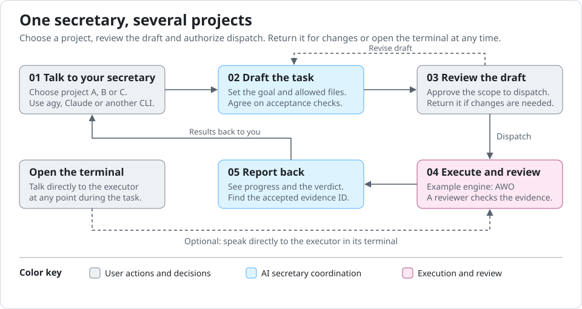

# MAID setup and operator guide

[Back to overview](../README.md)

English | [Chinese](setup.zh-CN.md)

**Multi-Agent Inter-harness Dispatch** is a project secretary for people managing several projects. Tell your secretary which project you mean and what you want to achieve. It drafts a task that spells out the goal, the files that may change and how the result will be checked. If the scope is wrong, ask for a revision. Only dispatch when you approve the draft.

The default secretary is **Antigravity CLI (agy)**. You can also use Claude or another local command. After dispatch, ask for progress, results and evidence, or open the terminal and talk directly to the executor.

## From a request to a reviewed result



The example below uses [AWO](https://github.com/cgy0071/agent-workflow-orchestrator#how-it-works) for execution and independent review. The projects are released separately. For this workflow, configure a compatible AWO checkout. AWO can also run without MAID.

1. Choose your secretary: Antigravity CLI (agy) or Claude.
2. Bind your Git project, allowed files and verification script with **configure.py**.
3. Use **request** to see the draft before any work is dispatched.
4. Use **start --confirm-execute** to authorize the example Codex worker.
5. Use **status** to find the review and evidence ID. Give each new task its own directory.

## Let your AI set this up

Copy this prompt into your assistant (for example, Codex, Claude Code, Antigravity CLI (agy) or Cursor):

```text
Check the paths and versions of Git and Python (3.10+). List installed clients by path or version without starting a session. Report missing prerequisites instead of installing them.
Use my chosen setup directory; ask me for it if missing. Clone only into new subdirectories and never overwrite existing files.
Clone tag v0.2.1 from https://github.com/cgy0071/MAID.git. For doctor, use my compatible AWO checkout if provided (set MAID_AWO_ROOT for this session only). Otherwise clone v1.1.1 from https://github.com/cgy0071/agent-workflow-orchestrator.git into a sibling directory named agent-workflow-orchestrator.
From MAID, use the checked interpreter to run python -B maid.py doctor. Record the detected backend path and exit code.
Do not modify my projects, access or change accounts or keys, make paid model calls, or dispatch real work. Report the environment, checkout paths, check results and the exact next command for me to run. Do not run that next step.
```

## Install and update on Windows

Install Git and Python 3.10 or later. To execute the example coding task, also install Codex CLI and sign in. Open PowerShell in a common parent directory and clone this tested pair:

~~~powershell
git clone --branch v0.2.1 https://github.com/cgy0071/MAID.git
git clone --branch v1.1.1 https://github.com/cgy0071/agent-workflow-orchestrator.git
cd MAID
python maid.py doctor
~~~

### Already have AWO?

Point MAID at your compatible checkout in the current PowerShell session:

~~~powershell
$env:MAID_AWO_ROOT = 'D:\Tools\agent-workflow-orchestrator'
python maid.py doctor
~~~

By default the backend looks for an agent-workflow-orchestrator directory next to MAID. Setting MAID_AWO_ROOT overrides that choice without fallback. Set it again in a new session if necessary.

If scripts/awo_app.py exists, the backend must advertise protocol 1 with the maid and profile capabilities. A failed check does not fall back to the legacy interface. The AWO v1.0.0 layout is used only when the public entry point is absent; it does not support scoped knowledge in ordinary requests. The doctor command shows the selected path and checks the entry point. It does not test model login or dispatch a task.

Update the repositories independently. On a MAID tracking branch, use git pull --ff-only. For a checkout pinned to a tag, fetch tags and switch to the desired compatible tag. After updating AWO, run python maid.py doctor again. Historical ZIP files are not needed.

## 1. Choose a secretary

Install and sign in to the CLI you want to use. Pick one line in PowerShell:

~~~powershell
$Secretary = 'agy'
# $Secretary = '.\examples\secretary-claude.json'
~~~

For a conversation without a project task, start a thread. Type exit to leave:

~~~powershell
python maid.py --thread "$env:LOCALAPPDATA\MAID\chat-01" chat --secretary $Secretary
~~~

With Antigravity CLI (agy), use `python maid.py direct --thread "$env:LOCALAPPDATA\MAID\chat-01" --secretary agy` to reopen the conversation. The example Claude profile starts a separate conversation for each turn. To connect another CLI, copy examples/secretary-claude.json and set turn to a trusted command that reads the prompt from standard input and writes the reply to standard output.

## 2. Set the project and allowed files

Use your repository path, allowed files and verification script. The example needs a Git repository with at least one commit, an app.py file and a verify.py script that exits nonzero when verification fails.

~~~powershell
$Project = 'D:\Projects\MyProject'
$Thread  = "$env:LOCALAPPDATA\MAID\task-01"
$Profile = "$Thread.json"

New-Item -ItemType Directory -Force (Split-Path $Thread) | Out-Null
python configure.py --project $Project --thread $Thread --allow app.py --verify-script verify.py --profile $Profile
~~~

The thread directory holds the draft and state. Keep it outside the repository; neither directory should contain the other. Choose a new thread path and let MAID create it. Repeat --allow for additional files. Configuration writes a local profile without calling a model or overwriting an existing profile.

## 3. Review the draft and authorize dispatch

~~~powershell
python maid.py request --profile $Profile --thread $Thread --secretary $Secretary "Fix the sum function in app.py so verify.py passes."
~~~

Check the goal and allowed paths. A response containing dispatched: false means the work has not started. Once you approve the scope, use the signed-in Codex CLI to perform the task and allow accepted changes to land on its task branch:

~~~powershell
python maid.py --thread $Thread start --confirm-execute
python maid.py --thread $Thread status
~~~

To check again in a new terminal, return to the MAID directory and restore the same thread path. Status retrieves the verdict and evidence ID without dispatching again.

## 4. Switch tasks or projects

For a new task, repeat step 2 with task-02 and a new profile. For a different project, also change the repository, allowed files and verification script. The target branch is `refs/heads/maid-<task-name>`, so use distinct task names within a repository.

To revisit earlier tasks:

~~~powershell
python maid.py --thread "$env:LOCALAPPDATA\MAID\task-01" status
python maid.py --thread "$env:LOCALAPPDATA\MAID\task-02" status
~~~

## Troubleshooting

| What you see | What to do |
| --- | --- |
| Incompatible AWO: ... lacks ... | Check the reported path and MAID_AWO_ROOT. If the interface is missing, clone the compatible AWO v1.1.1 tag separately. |
| Doctor works but request cannot find Antigravity CLI (agy) | Check that the `agy` command runs in this terminal. For Claude, select the example Claude profile and sign in to Claude CLI. |
| Verification script missing or profile already exists | Use a script inside the project and a fresh task name for each new profile. |
| Draft says dispatched: false | Review the scope before starting. If unsure whether an earlier task started, check status first. |
| Results missing after switching projects | Run status with the original thread path from the MAID directory. Do not start the task again. |

## Advanced: manage several projects by name

Run python maid.py runs --help. The local index maps project and task names to paths; AWO retains the authoritative task state, evidence and recovery decisions. Reuse the same index after restarting PowerShell.

Example index for D:/Work/index.json:

~~~json
{"projects":{
  "research":{"repository":"research","runs":{"analysis":{"spec":"profiles/analysis.json","thread":"tasks/analysis"}}},
  "report":{"repository":"report","runs":{"revision":{"spec":"profiles/revision.json","thread":"tasks/revision"}}}
}}
~~~

Relative paths start at the index directory. Generate each profile with configure.py, set its goal, and check that its repository, allowed files and thread agree with the index. With a compatible AWO version:

~~~powershell
$Index = 'D:\Work\index.json'
python maid.py runs --index $Index list
python maid.py runs --index $Index --project research --run analysis prepare
python maid.py runs --index $Index --project research --run analysis start --confirm-execute
python maid.py runs --index $Index --project research --run analysis status
~~~

Switch to --project report --run revision for the other project. Reuse status after restarting. For an interrupted task, recover diagnoses the run without changing it; add --confirm-execute only to resume. Named runs are for tasks prepared from profiles. With AWO v1.0.0, use the earlier request and thread-based start/status commands.

### Share workers and budget within a project

For a project with an AWO controller, add a scheduler entry to its index record:

~~~json
{"scheduler":{"state":"state/research","project_id":"YOUR_PROJECT_ID","token_file":"private/research.token"}}
~~~

Keep the credential outside the code repository; store only its path in the index. Run python maid.py shared --help for all options.

~~~powershell
python maid.py shared --index $Index --project research command --file .\create-task.json
python maid.py shared --index $Index --project research command --file .\enqueue.json
python maid.py shared --index $Index --project research command --file .\claim.json
python maid.py shared --index $Index --project research status --task T-A
~~~

The command files use the controller's task creation, enqueue and claim formats. After a claim, use dispatch --assignment ID --epoch N with the returned assignment and epoch. Tasks under the same controller share workers, budget and write protections; separate controllers remain independent. Query by project and task ID after reopening. This requires an AWO backend supporting awo_project.py schedule.

## Advanced: read authorized project knowledge (v0.2.1)

With AWO v1.1.1, add --directory CATALOG.json --project PROJECT_KEY --material DOCUMENT_KEY to request. The secretary can read the specified published document. Both drafting and task preparation check its revision and permission. Revoking access blocks subsequent reads.

[How the secretary reports to the Owner (Chinese)](../SECRETARY.md)
